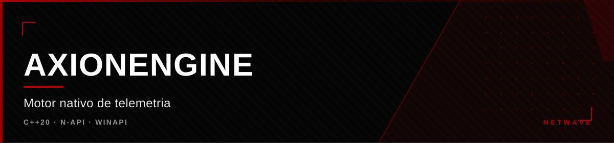
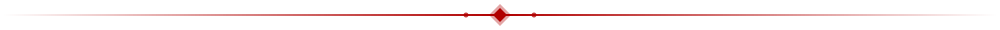

<div align="center">



</div>

<div align="center">

[](https://github.com/hiro0010/axionengine) [](https://github.com/hiro0010/axionengine) [](https://github.com/hiro0010/axionengine) [](https://github.com/hiro0010/axionengine)

</div>



## O que é

Addon nativo em C++ que serve de **camada de telemetria e otimização de
hardware** para o painel Axiom. É uma DLL exposta como módulo N-API
(Node-API), carregada pelo processo Electron do Axiom.

**Não é um kernel driver.** É user-mode. O projeto já foi chamado de `kernel`
por herança de nomenclatura, mas nunca teve — nem terá — código em modo
kernel: a separação user/kernel não existe no design atual.

---

## Como funciona

```
Electron (frontend) → N-API exports → AxiomAPI::GetFullTelemetry()
  → Engine::GetInstance().GetTelemetry().GetSnapshot()
  → TelemetryManager → coletores (CPU, GPU, memória, storage, rede,
                        temperatura, energia, fan, uptime)
  → TelemetrySnapshot → objeto JS
```

### Componentes

| Componente | Papel |
|---|---|
| `Engine` | Singleton de ciclo de vida — `Initialize()` / `Shutdown()` |
| `AxiomAPI` / `AxiomExports` | Roteadores e exportadores N-API |
| `TelemetryManager` | Inicializa os coletores e monta o snapshot |
| Coletores | 11 fontes de dados de hardware agregadas num único objeto |

A comunicação entre módulos é **chamada direta via singleton** — sem IPC,
callbacks ou pipes.

---

## Stack

| Camada | Tecnologia |
|---|---|
| Linguagem | C++20 |
| Build | CMake (mín. 3.15) |
| Runtime | Windows x64 · user-mode (MSVC) |
| Ponte | N-API / Node-API |
| APIs | WinAPI — `iphlpapi`, `ws2_32`, `psapi`, `tlhelp32`, `kernel32` |

---

## Roadmap

O escopo planejado inclui uma suíte de otimização de hardware integrada ao
Axiom: cleaners, perfis de performance, tweaks de sistema e overlay. Hoje o
núcleo de **telemetria** é o que existe de fato; o restante está em
desenvolvimento.

A integração com o Axiom é projetada — o addon foi construído **para** o
painel — e está sendo conectada ao lado do app.

---

## Status

Estágio inicial. O núcleo de telemetria usermode está parcialmente
funcional. O projeto está sendo finalizado para compilação limpa e consumo
pelo painel.


<div align="center">

<sub>Parte da <a href="https://github.com/hiro0010/netwave">Netwave</a>
&middot; Owner: <a href="https://github.com/hiro0010">Hiro</a></sub>

</div>
